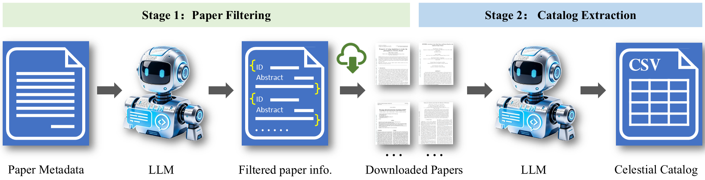
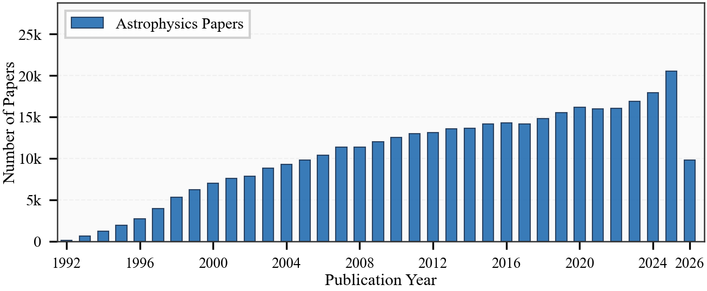
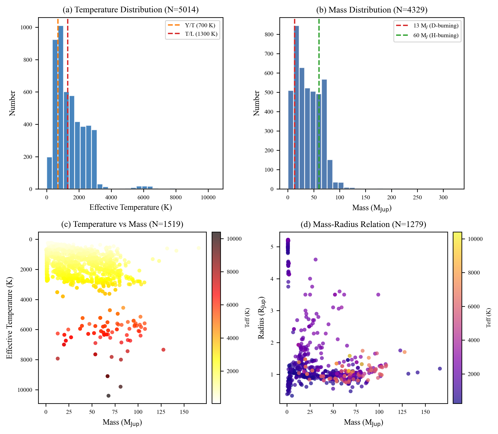
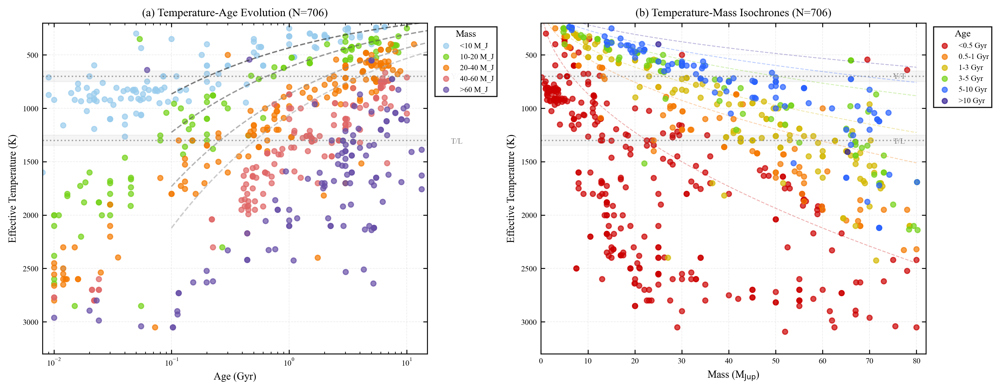
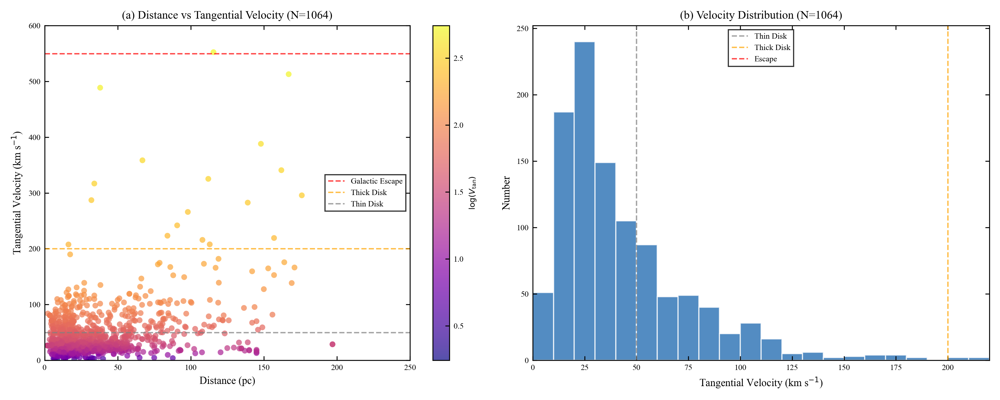
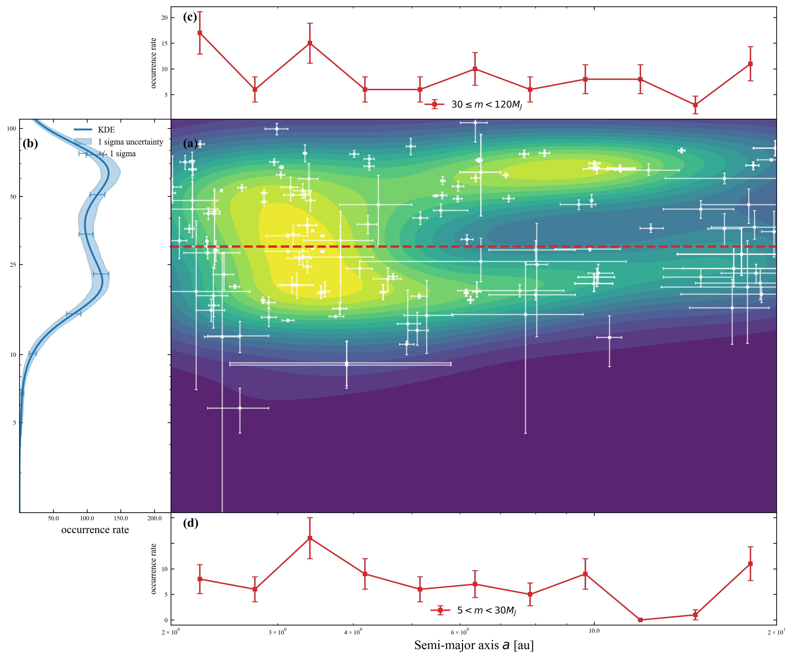

# Automatic Celestial Catalog Extraction Using Large Language Models

<p align="center">

[](...)
[](...)
</p>


Official implementation of the paper

> **Automatic Celestial Catalog Extraction Using Large Language Models**

**Authors**

Jun-Hao Peng, Yi-Cheng Rui, Peng-Ju Wang, Wen-Yong Kang, Yu-Long Gao, Zheng-Jun Du

---

## Overview

Large Language Models (LLMs) have recently demonstrated remarkable capabilities in scientific document understanding. This repository presents an automated pipeline for constructing celestial catalogs directly from astrophysical literature by combining large-scale arXiv retrieval, semantic paper filtering, and LLM-based information extraction.

Unlike conventional object-oriented catalogs, our database adopts a **literature-centric** organization, where every extracted record preserves its original publication provenance, allowing multiple independent measurements of the same object to coexist.

The complete workflow consists of two major stages:

1. **Paper Filtering**
   - Automatically screens approximately **340,000** arXiv astrophysical papers.
   - Identifies publications containing brown dwarf observations.

2. **Catalog Extraction**
   - Downloads PDFs automatically.
   - Extracts celestial objects and physical parameters.
   - Preserves literature provenance.
   - Produces a structured CSV catalog.

---

## Pipeline

<p align="center">

</p>

**Figure 2.** Overview of the automated literature-mining pipeline used for constructing the brown dwarf catalog.

---

## Highlights

- Automated processing of **340,000+** arXiv papers
- Literature-centric astronomical catalog
- Provenance-preserving information extraction
- Parallel PDF processing
- Multi-model LLM benchmark
- Reproducible scientific analysis

---

## Key Results

| Metric | Result |
|---------|--------|
| Papers processed | **1,410** |
| Unique brown dwarfs | **17,793** |
| Measurement records | **41064** |
| Processing time | **~40 minutes** |
| Total API cost | **$22.36** |
| Selected model | **DeepSeek-V4-Flash** |
| Best F1 score | **94.67%** |

---

## Repository Structure

```text
.
├── Figures/                                   # Figures used in the paper
│   ├── Pipeline.png
│   ├── Pipeline.pdf
│   ├── arxiv_astrophysics_yearly.pdf
│   ├── catalog_summary.pdf
│   ├── age_temp_cooling_evolution.pdf
│   ├── kinematic_analysis.pdf
│   └── mass_semimajor.pdf
│
├── analysis_experiment/                       # Scripts for reproducing figures
│   ├── catalog_summary.py
│   ├── age_temp_cooling_evolution.py
│   ├── kinematic_analysis.py
│   └── mass_semimajor.py
│
├── valid_experiments/                         # LLM benchmark experiments
│   ├── dataset.xlsx
│   ├── metric.py
│   ├── test_set.json
│   ├── valid_set.json
│   ├── valid_set_claude_haiku_4_5.csv
│   ├── valid_set_deepseek_v4_flash.csv
│   ├── valid_set_deepseek_v4_pro.csv
│   ├── valid_set_gemini_3_5_flash.csv
│   ├── valid_set_gpt_5_4_mini.csv
│   └── valid_set_qwen_long.csv
│
├── brown_dwarf.csv                            # Final brown dwarf catalog
├── config.py                                 # Configuration file
├── extraction_chain_stream_parallel.py        # Main extraction pipeline
├── filter_chain.py                           # Paper filtering pipeline
├── prompts.py                               # Prompt templates
├── requirements.txt                         # Python dependencies
├── validate_brown_dwarf.json                # Filtered paper list
└── README.md

```

---

## Repository Description

| File / Directory | Description |
|------------------|-------------|
| **Figures/** | Publication-quality figures used in the paper |
| **analysis_experiment/** | Scripts for reproducing all scientific figures |
| **valid_experiments/** | Benchmark datasets and evaluation results |
| **brown_dwarf.csv** | Final literature-centric brown dwarf catalog |
| **filter_chain.py** | LLM-based paper filtering from arXiv |
| **extraction_chain_stream_parallel.py** | Parallel extraction pipeline |
| **prompts.py** | Prompt templates used for information extraction |
| **config.py** | API configuration and runtime settings |
| **requirements.txt** | Required Python packages |

---

## Repository Contents

This repository contains four major components.

### 1. Extraction Pipeline

The complete LLM-based extraction framework for automatically constructing celestial catalogs from astrophysical literature.

Main modules include

- paper filtering
- PDF downloading
- document chunking
- LLM inference
- result aggregation
- catalog generation

---

### 2. Benchmark Dataset

The manually annotated benchmark used for evaluating different Large Language Models.

Included files

- validation dataset
- test dataset
- prediction outputs
- evaluation scripts

---

### 3. Scientific Analysis

Scripts used to generate all figures presented in the paper, including

- parameter distributions
- cooling evolution
- kinematic analysis
- orbital properties

All figures can be reproduced directly from the released catalog.

---

### 4. Brown Dwarf Catalog

The released catalog contains

- **17,793** unique brown dwarfs (deduplicated by Name field)
- **41064** literature measurement records

Each record preserves the original publication provenance, enabling literature-level analyses instead of only object-level summaries.

---


## Installation

### Requirements

The pipeline has been tested with the following software environment.

| Package | Version |
|----------|---------|
| Python | 3.11+ |
| OpenAI Python SDK | 1.95.0 |
| LangChain | 1.0+ |
| pandas | 2.3.1 |
| NumPy | 1.26.4 |
| SciPy | 1.16.1 |
| Matplotlib | 3.10.6 |
| PyMuPDF | 1.26.7 |

All additional dependencies can be installed via

```bash
pip install -r requirements.txt
```

---

### Clone the Repository

```bash
git clone https://github.com/0307pjh/Automatic-Celestial-Catalog-Extraction.git

cd Automatic-Celestial-Catalog-Extraction
```

---

### Create a Virtual Environment

Using **venv**

```bash
python -m venv venv
```

Linux / macOS

```bash
source venv/bin/activate
```

Windows

```bash
venv\Scripts\activate
```

Alternatively, using Conda

```bash
conda create -n celestial python=3.11

conda activate celestial
```

---

### Install Dependencies

```bash
pip install -r requirements.txt
```

---

## Configuration

Before running the pipeline, configure the required API keys.

The recommended approach is to create a `.env` file in the project root.

Example

```text
DEEPSEEK_API_KEY=xxxxxxxxxxxxxxxx
OPENAI_API_KEY=xxxxxxxxxxxxxxxx
QWEN_API_KEY=xxxxxxxxxxxxxxxx
BAIDU_API_KEY=xxxxxxxxxxxxxxxx
AIHUBMIX_API_KEY=xxxxxxxxxxxxxxxx
```

Alternatively, the API keys can be specified directly in

```text
config.py
```

depending on your deployment environment.

---

## Input Data

The pipeline accepts astrophysical papers obtained from the arXiv repository.

The filtering stage automatically identifies brown dwarf related publications from the downloaded metadata.

The paper list used in this work is provided as

```text
validate_brown_dwarf.json
```

---

## Output

The final catalog is exported as

```text
brown_dwarf.csv
```

Each row corresponds to **one literature report** rather than one merged object.

Representative fields include

| Field | Description |
|---------|-------------|
| Name | Object name |
| SpectralType | Spectral classification |
| Mass_MJ | Mass |
| Radius_RJ | Radius |
| EffectiveTemperature_K | Effective temperature |
| Distance_pc | Distance |
| ProperMotion_RA_mas_yr | Proper motion (RA) |
| ProperMotion_Dec_mas_yr | Proper motion (Dec) |
| Age_Gyr | Age |
| SemiMajorAxis_AU | Semi-major axis |
| paper_id | arXiv identifier |
| source_pages | Source pages |
The catalog preserves the original values reported in the literature whenever possible instead of replacing them with normalized or merged measurements.

---

## Supported Models

The extraction framework currently supports multiple Large Language Models through a unified interface.

| Model | Status |
|---------|--------|
| DeepSeek-V4-Flash | ✅ |
| DeepSeek-V4-Pro | ✅ |
| GPT-5.4-Mini | ✅ |
| Claude-Haiku-4.5 | ✅ |
| Gemini-3.5-Flash | ✅ |
| Qwen-Long | ✅ |

Additional models can be integrated by modifying the configuration in `config.py`.

---

## Usage

The complete workflow consists of two sequential stages:

1. **Paper Filtering**
2. **Catalog Extraction**

The pipeline is fully automated and supports parallel processing.

---

## Step 1. Paper Filtering

The first stage identifies publications relevant to brown dwarf studies from the downloaded arXiv metadata.

Run

```bash
python filter_chain.py
```

Output

```text
validate_brown_dwarf.json
```

This file contains all papers selected for the extraction stage.

---

## Step 2. Catalog Extraction

Run the extraction pipeline

```bash
python extraction_chain_stream_parallel.py
```

The pipeline automatically performs

- PDF downloading
- PDF chunking
- parallel LLM inference
- structured information extraction
- CSV generation

The final catalog is exported as

```text
brown_dwarf.csv
```

---

## Optional Arguments

### Force Reprocessing

Ignore cached results and reprocess all papers.

```bash
python extraction_chain_stream_parallel.py --force
```

---

### Retry Failed Papers

Only process papers that previously failed.

```bash
python extraction_chain_stream_parallel.py --retry-failed
```

---

### Parallel Processing

Specify the number of workers.

```bash
python extraction_chain_stream_parallel.py \
    --max-workers 50 \
    --chunk-workers 25
```

Increasing the number of workers generally improves throughput but also increases API concurrency.


## Benchmark Evaluation

To reproduce the benchmark reported in the paper

```bash
cd valid_experiments

python metric.py
```

The evaluation computes

- Precision
- Recall
- F1 Score

for all supported Large Language Models.

---

## Reproducing Figures

All analysis scripts are located in

```text
analysis_experiment/
```

### Figure 3

Physical parameter distributions

```bash
python analysis_experiment/catalog_summary.py
```

---

### Figure 4

Cooling evolution

```bash
python analysis_experiment/age_temp_cooling_evolution.py
```

---

### Figure 5

Brown dwarf kinematics

```bash
python analysis_experiment/kinematic_analysis.py
```

---

### Figure 6

Mass versus semi-major axis

```bash
python analysis_experiment/mass_semimajor.py
```

All figures are exported into

```text
Figures/
```

in publication-quality PDF format.

---

## Reproducibility

This repository contains everything required to reproduce the experiments reported in the paper, including

- benchmark datasets
- evaluation scripts
- extraction prompts
- analysis scripts
- generated figures
- extracted catalog

Running the pipeline with the same configuration should reproduce results that are consistent with those presented in the manuscript, subject to minor stochastic variations introduced by LLM inference.

---

## LLM Benchmark Results

To evaluate the effectiveness of Large Language Models for astronomical information extraction, we constructed a manually annotated benchmark consisting of

- **Validation set:** 60 papers containing **2,818** annotated entities
- **Test set:** 60 papers containing **1,511** annotated entities

The benchmark evaluates both celestial object identification and structured parameter extraction.

---

### Performance Comparison

| Model | Precision ↑ | Recall ↑ | F1 ↑ | API Time ↓ | Total Time ↓ | Cost ↓ |
|:------|------------:|---------:|------:|-----------:|-------------:|--------:|
| Gemini-3.5-Flash | 94.95% | 88.15% | 91.42% | 23.82 s | 5811.4 s | $69.01 |
| Claude-Haiku-4.5 | 96.04% | 56.00% | 70.75% | 7.84 s | 2657.4 s | $21.06 |
| GPT-5.4-Mini | 92.21% | 72.25% | 81.02% | **3.56 s** | **888.8 s** | $6.29 |
| DeepSeek-V4-Pro | **97.00%** | **94.14%** | **95.55%** | 51.90 s | 18343.8 s | $6.86 |
| **DeepSeek-V4-Flash** | 96.81% | 92.62% | **94.67%** | 19.83 s | 4762.4 s | $1.47 |
| Qwen-Long | 96.00% | 86.94% | 91.25% | 12.58 s | 4461.0 s | **$0.80** |

---

### Model Selection

Among all evaluated models, **DeepSeek-V4-Flash** provides the best overall trade-off between

- extraction accuracy,
- inference efficiency,
- deployment cost

Consequently, it was selected as the default model for constructing the complete brown dwarf catalog presented in this work.

---

### Benchmark Dataset

The complete benchmark is provided in

```text
valid_experiments/
```

including

```text
dataset.xlsx
metric.py
valid_set.json
test_set.json
```

together with the prediction outputs generated by all evaluated models.

---

### Evaluation Metrics

The benchmark reports the three standard information extraction metrics.

| Metric | Description |
|---------|-------------|
| Precision | Fraction of extracted entities that are correct |
| Recall | Fraction of annotated entities successfully extracted |
| F1 Score | Harmonic mean of Precision and Recall |

The F1 score is used as the primary evaluation metric throughout the paper.

---

### Discussion

The benchmark demonstrates that extraction quality is not solely determined by model size.

- **DeepSeek-V4-Pro** achieved the highest overall extraction accuracy.
- **GPT-5.4-Mini** exhibited the fastest inference speed.
- **Qwen-Long** achieved the lowest monetary cost.
- **DeepSeek-V4-Flash** provided the most balanced performance and was therefore adopted for large-scale catalog construction.

---

### Large-scale Deployment

Using **DeepSeek-V4-Flash**, the complete pipeline processed

- **1,410** astrophysical papers,
- **17,793** unique brown dwarfs,
- **41064** literature measurement records,

within approximately **40 minutes** at a total API cost of **$22.36**, demonstrating the practicality of LLM-based astronomical catalog construction for large-scale literature mining.

---

---

# Scientific Results

The literature-centric brown dwarf catalog enables a variety of statistical analyses that are difficult to perform using conventional object-oriented catalogs.

## Catalog Statistics

The current release contains

| Property | Value |
|----------|------:|
| Processed papers | 1,410 |
| Unique brown dwarfs | 17,793 |
| Literature records | 41064 |
| Objects with spectral classifications | 11,884 |
| Objects appearing in multiple papers | 2,413 |
| Objects with multiple spectral classifications | 1,735 |

Unlike conventional catalogs, every record preserves its original literature provenance, allowing users to trace the evolution of published measurements over time.

---

## Figure 1. arXiv Paper Statistics

<p align="center">

</p>

Annual statistics of astrophysics papers collected from the arXiv repository and the subset selected for brown dwarf catalog construction.

---

## Figure 2. Extraction Pipeline

<p align="center">

</p>

Overview of the automated extraction framework, including paper filtering, PDF processing, LLM-based information extraction, and catalog generation.

---

## Figure 3. Catalog Summary

<p align="center">

</p>

Statistical distributions of the physical parameters preserved in the literature-centric catalog.

---

## Figure 4. Brown Dwarf Cooling Evolution

<p align="center">

</p>

Relationships among effective temperature, age, and mass for brown dwarfs with complete evolutionary measurements.

---

## Figure 5. Kinematic Analysis

<p align="center">

</p>

Tangential velocity distribution and Galactic population classification derived from proper motions and distances.

---

## Figure 6. Mass versus Orbital Semi-major Axis

<p align="center">

</p>

Distribution of brown dwarf companion masses as a function of orbital semi-major axis, illustrating the brown dwarf desert and different orbital regimes.

---

## Scientific Applications

The catalog supports numerous research applications, including

- Literature-based brown dwarf catalog construction
- Evolution of spectral classifications
- Comparison of independent physical measurements
- Population statistics
- Brown dwarf cooling studies
- Galactic kinematics
- Companion demographics
- Evidence tracing across publications
- AI-assisted astronomical literature mining

Because every measurement retains its original publication information, users can directly compare independent studies without losing provenance.

---

---

# Data Availability

The literature-centric brown dwarf catalog generated in this work is publicly available with this repository.

## Included Data

| File | Description |
|------|-------------|
| `brown_dwarf.csv` | Complete extracted brown dwarf catalog |
| `validate_brown_dwarf.json` | Filtered arXiv paper list |
| `valid_experiments/dataset.xlsx` | Benchmark annotation dataset |
| `valid_experiments/valid_set.json` | Validation benchmark |
| `valid_experiments/test_set.json` | Test benchmark |

---

## Catalog Characteristics

The catalog differs from conventional astronomical catalogs in that **each row corresponds to one literature measurement rather than one merged object**.

For every extracted record, the catalog preserves

- object identifier
- physical parameters
- uncertainty information
- source publication
- DOI (when available)
- page number
- text location
- original literature expression

This design enables complete provenance tracking and facilitates evidence-based astronomical research.

---

## Reproducibility

All experiments presented in the paper can be reproduced using the materials provided in this repository.

The repository includes

- complete extraction prompts
- benchmark datasets
- evaluation scripts
- analysis scripts
- visualization scripts
- generated catalog

No proprietary software is required beyond access to the corresponding LLM APIs.

---

---

# Future Outlook

We are actively extending this project beyond literature-based catalog construction toward AI-assisted astronomical knowledge discovery.

Current directions include:

- **Natural-language Catalog Agent.**  
  We have developed an initial intelligent agent that enables users to query the literature-centric brown dwarf catalog using natural language. The system is currently undergoing security review and usability evaluation before public release.

- **Literature Knowledge Base.**  
  We are constructing a knowledge base by encoding astrophysical literature into structured representations. This effort aims to expand the capabilities of the intelligent agent beyond catalog retrieval, enabling evidence tracing, scientific reasoning, and knowledge-aware question answering over the astronomical literature.

- **Expanded Celestial Catalogs.**  
  Although this work focuses on brown dwarfs, the proposed framework is designed to be generalizable. Future releases will extend the extraction pipeline to additional classes of celestial objects, including exoplanets, stars, galaxies, and other astrophysical sources.

- **Continuous Catalog Updates.**  
  We plan to periodically synchronize newly submitted arXiv papers and update the catalog automatically, allowing the database to evolve together with the astronomical literature.

---

# Citation

If you find this repository useful in your research, please cite our paper.

```bibtex
@article{peng2026automatic,
  title={Automatic Celestial Catalog Extraction Using Large Language Models},
  author={Peng, Jun-Hao and Rui, Yi-Cheng and Wang, Peng-Ju and Kang, Wen-Yong and Gao, Yu-Long and Du, Zheng-Jun},
  journal={},
  year={2026}
}
```

If you use the extracted catalog, benchmark dataset, or analysis scripts, please cite both this paper and the corresponding data release.

---

## Related Resources

- arXiv paper *(coming soon)*
- Zenodo dataset *(coming soon)*
- Project homepage *(coming soon)*

These links will be updated after publication.

---

---

# License

This project is released under the **MIT License**.

See the [LICENSE](LICENSE) file for the complete license text.

---

# Acknowledgments

This work was supported in part by

- **Qinghai University Research Ability Enhancement Project**
  (Grant No. **2025KTSQ26**)

- **National Natural Science Foundation of China**
  (Grant No. **62562052**)

We sincerely thank the developers and maintainers of the following open-source projects:

- arXiv
- NASA ADS
- Astropy
- pandas
- NumPy
- SciPy
- Matplotlib
- LangChain
- OpenAI API
- DeepSeek API

Their contributions made this work possible.

---

# Contributing

Contributions are welcome.

If you find bugs, have suggestions, or would like to improve the project, please

- Open an Issue
- Submit a Pull Request
- Start a Discussion

Please ensure that any submitted code follows the existing coding style and includes appropriate documentation.

---

# Contact

For questions regarding the paper, the catalog, or the source code, please contact the corresponding authors.

**Yi-Cheng Rui**

Email: `your_email@example.com`

**Zheng-Jun Du**

Email: `dzj@qhu.edu.cn`

You are also welcome to open a GitHub Issue for technical questions or bug reports.

---

# Star History

If you find this project helpful, please consider giving it a ⭐ on GitHub.

It helps increase the visibility of the project and supports future development.

---

<p align="center">

**Automatic Celestial Catalog Extraction Using Large Language Models**

*Literature-centric astronomical catalogs powered by Large Language Models.*

</p>
