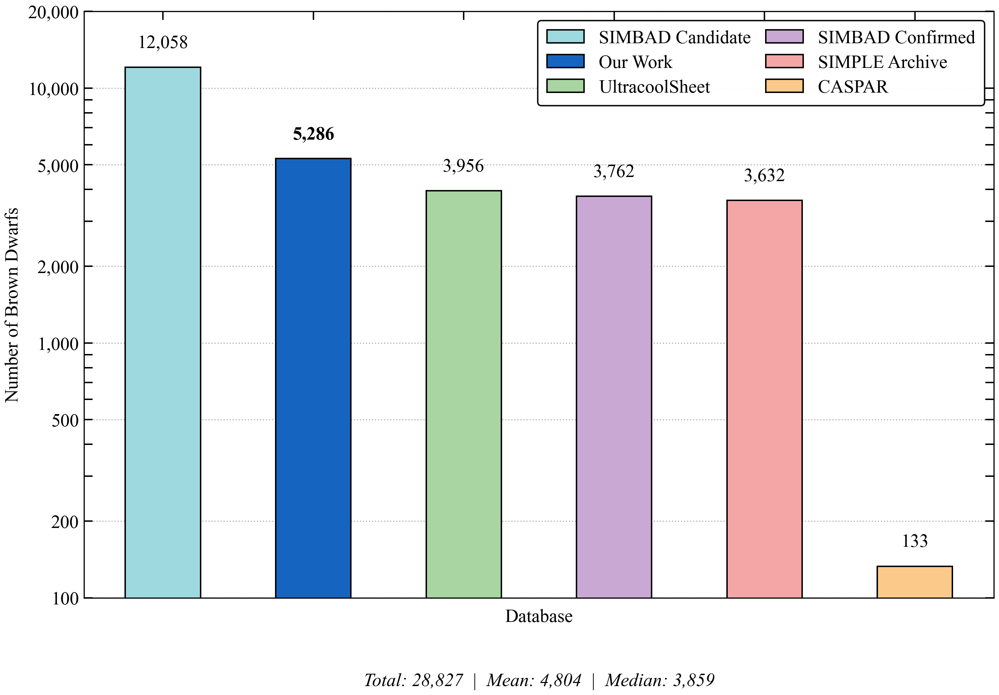
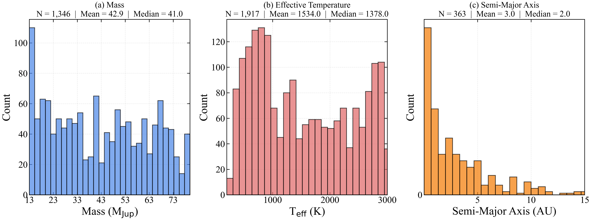
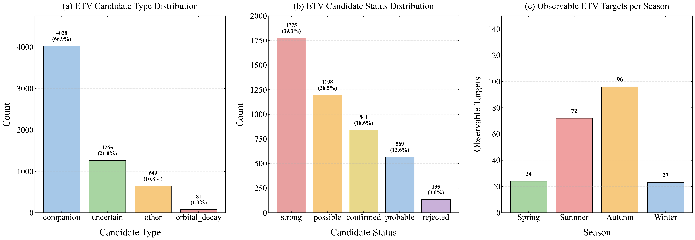
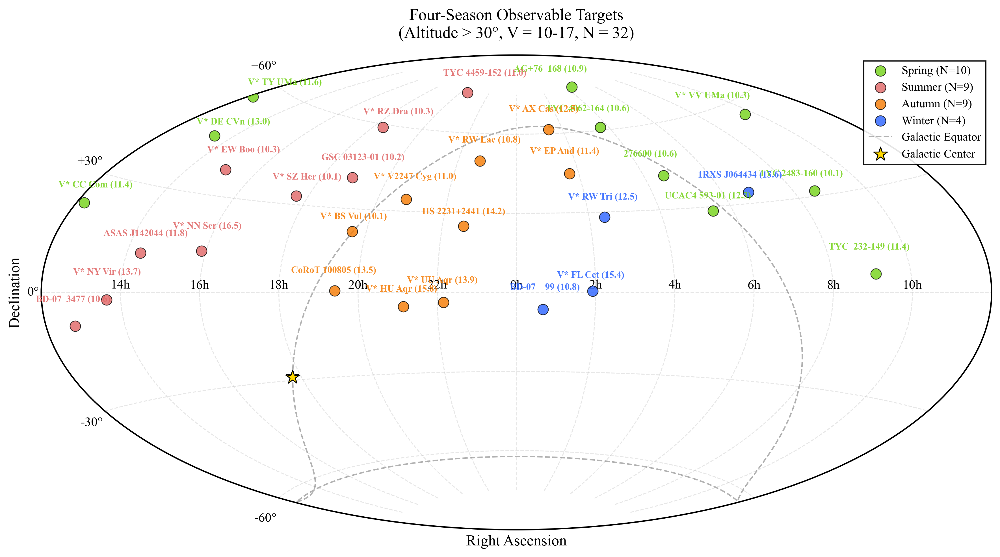

# Automatic Celestial Catalog Extraction Using Large Language Models

<p align="center">

[](...)
[](...)
</p>


Official implementation of the paper

> **Automatic Celestial Catalog Extraction Using Large Language Models**

**Authors**

Jun-Hao Peng, Yi-Cheng Rui, Peng-Ju Wang, Wen-Yong Kang, Yu-Long Gao, Fa-Bo Feng, Yun-Hai Wang, Zheng-Jun Du

*Jun-Hao Peng and Yi-Cheng Rui contributed equally to this work. Corresponding author: Zheng-Jun Du.*

---

## Table of Contents

- [Overview](#overview)
- [Pipeline](#pipeline)
- [Highlights](#highlights)
- [Key Results](#key-results)
- [Repository Structure](#repository-structure)
- [Repository Description](#repository-description)
- [Repository Contents](#repository-contents)
- [Installation](#installation)
- [Configuration](#configuration)
- [Input Data](#input-data)
- [Output](#output)
- [Supported Models](#supported-models)
- [Usage](#usage)
- [Optional Arguments](#optional-arguments)
- [Benchmark Evaluation](#benchmark-evaluation)
- [Reproducing Figures](#reproducing-figures)
- [Scientific Results](#scientific-results)
- [Data Availability](#data-availability)
- [Future Outlook](#future-outlook)
- [Citation](#citation)
- [Related Resources](#related-resources)
- [License](#license)
- [Acknowledgments](#acknowledgments)
- [Contributing](#contributing)
- [Contact](#contact)

---

## Overview

Large Language Models (LLMs) have recently demonstrated remarkable capabilities in scientific document understanding. This repository presents an automated pipeline for constructing celestial catalogs directly from astrophysical literature by combining large-scale arXiv retrieval, semantic paper filtering, and LLM-based information extraction.

Unlike conventional object-oriented catalogs, our database adopts a **literature-centric** organization, where every extracted record preserves its original publication provenance, allowing multiple independent measurements of the same object to coexist.

The complete workflow consists of two major stages:

1. **Paper Filtering**
   - Automatically screens approximately **340,000** arXiv astrophysical papers.
   - Identifies publications containing the target objects (e.g., brown dwarfs).

2. **Catalog Extraction**
   - Downloads PDFs automatically.
   - Extracts celestial objects and physical parameters.
   - Preserves literature provenance.
   - Produces structured CSV catalogs.

The framework is applied to **two downstream applications** in the paper:

- **Brown dwarf catalog extraction** for statistical studies.
- **Eclipse timing variation (ETV) catalog extraction** for constructing a follow-up observation target list.

---

## Pipeline

<p align="center">

</p>

**Figure 2.** Overview of the automated literature-mining pipeline used for constructing celestial catalogs.

---

## Highlights

- Automated processing of **340,000+** arXiv papers
- Two downstream applications: **brown dwarf catalog** and **ETV target list**
- Literature-centric astronomical catalog
- Provenance-preserving information extraction
- Parallel PDF processing
- Multi-model LLM benchmark (including agent-based evaluation)
- Reproducible scientific analysis

---

## Key Results

| Metric | Result |
|---------|--------|
| Papers processed (brown dwarf) | **1,410** |
| Papers processed (ETV) | **261** |
| Brown dwarf measurement records | **47,266** |
| Unique standardized identifiers (brown dwarfs) | **14,682** |
| SIMBAD-retrievable brown dwarfs | **5,286** |
| ETV measurement records | **6,326** |
| Unique ETV candidates for follow-up | **345** |
| Observable ETV targets (at least one season) | **129** |
| Processing time | **~100 minutes** (6,017 s) |
| Total API cost | **$59.23** |
| Selected model | **DeepSeek-V4-Flash** |
| Best F1 score | **94.67%** |

---

## Repository Structure

```text
.
├── Figures/                                   # Figures used in the paper
│   ├── Pipeline.png
│   ├── Pipeline.pdf
│   ├── arxiv_astrophysics_yearly.pdf          # Figure 1
│   ├── database_comparison.pdf                # Figure 3
│   ├── brown_dwarf_histograms_3panel.pdf      # Figure 4
│   ├── etv_statistics_panel.pdf               # Figure 5
│   └── aitoff_manuscript.pdf                  # Figure 6
│
├── analysis_experiment/                       # Scripts for reproducing figures
│   ├── arxiv_paper_statistics.py              # Figure 1: arXiv paper statistics
│   ├── database_comparison.py                 # Figure 3: catalog comparison
│   ├── brown_dwarf_histograms.py              # Figure 4: parameter histograms
│   ├── etv_statistics.py                      # Figure 5: ETV statistics
│   ├── aitoff_sky_map.py                      # Figure 6: Aitoff all-sky map
│   └── etv_observable_targets.py              # ETV post-processing pipeline
│
├── valid_experiments/                         # LLM benchmark experiments
│   ├── dataset.xlsx
│   ├── metric.py
│   ├── test_set.json
│   ├── valid_set.json
│   ├── valid_set_claude_haiku_4_5.csv
│   ├── valid_set_deepseek_v4_flash.csv
│   ├── valid_set_deepseek_v4_pro.csv
│   ├── valid_set_gemini_3_5_flash.csv
│   ├── valid_set_gpt_5_4_mini.csv
│   ├── valid_set_gpt_5_6_sol.csv
│   └── valid_set_qwen_long.csv
│
├── etv_experiments/                           # ETV follow-up target products
│   ├── observable_targets_spring.csv          # 24 targets
│   ├── observable_targets_summer.csv          # 72 targets
│   ├── observable_targets_autumn.csv          # 96 targets
│   ├── observable_targets_winter.csv          # 23 targets
│   ├── all_unique_observable_targets.csv      # 129 unique targets
│   ├── etv_all_seasons_altitude.csv           # 345 candidates with seasonal altitudes
│   └── season_comparison_report.csv           # Seasonal comparison report
│
├── brown_dwarf.csv                            # Final brown dwarf catalog (47,266 records)
├── etv.csv                                    # Final ETV catalog (6,326 records)
├── config.py                                 # Configuration file
├── extraction_chain_stream_parallel.py        # Main extraction pipeline
├── filter_chain.py                           # Paper filtering pipeline
├── prompts.py                               # Prompt templates (TEST / FILTER / BROWN_DWARF / ETV)
├── requirements.txt                         # Python dependencies
├── validate_brown_dwarf.json                # Filtered paper list
└── README.md

```

---

## Repository Description

| File / Directory | Description |
|------------------|-------------|
| **Figures/** | Publication-quality figures used in the paper |
| **analysis_experiment/** | Scripts for reproducing all scientific figures |
| **valid_experiments/** | Benchmark datasets and evaluation results |
| **etv_experiments/** | ETV follow-up target lists and seasonal products |
| **brown_dwarf.csv** | Final literature-centric brown dwarf catalog |
| **etv.csv** | Final ETV measurement catalog |
| **filter_chain.py** | LLM-based paper filtering from arXiv |
| **extraction_chain_stream_parallel.py** | Parallel extraction pipeline |
| **prompts.py** | Prompt templates: TEST (benchmark), FILTER, BROWN_DWARF and ETV extraction prompts |
| **config.py** | API configuration and runtime settings |
| **requirements.txt** | Required Python packages |

---

## Repository Contents

This repository contains four major components.

### 1. Extraction Pipeline

The complete LLM-based extraction framework for automatically constructing celestial catalogs from astrophysical literature.

Main modules include

- paper filtering
- PDF downloading
- document chunking
- LLM inference
- result aggregation
- catalog generation

---

### 2. Benchmark Dataset

The manually annotated benchmark used for evaluating different Large Language Models.

Included files

- validation dataset
- test dataset
- prediction outputs
- evaluation scripts

---

### 3. Scientific Analysis

Scripts used to generate all figures presented in the paper, including

- arXiv paper statistics
- database comparison
- brown dwarf parameter distributions
- ETV statistics
- ETV sky distribution

All figures can be reproduced directly from the released catalogs.

---

### 4. Celestial Catalogs

The released catalogs contain

- **Brown dwarf catalog**: 47,266 measurement records, 14,682 unique standardized identifiers (5,286 retrievable in SIMBAD), and 216 extracted fields.
- **ETV catalog**: 6,326 measurement records covering more than 2,000 objects, with 345 unique ETV candidates for follow-up confirmation and 129 observable targets from the Lenghu site.

Each record preserves the original publication provenance, enabling literature-level analyses instead of only object-level summaries.

---

## Installation

### Requirements

The pipeline has been tested with the following software environment.

| Package | Version |
|----------|---------|
| Python | 3.11+ |
| OpenAI Python SDK | 1.95.0 |
| LangChain | 1.0+ |
| pandas | 2.3.1 |
| NumPy | 1.26.4 |
| SciPy | 1.16.1 |
| Matplotlib | 3.10.6 |
| PyMuPDF | 1.26.7 |
| Astropy | 7.2.1 |

All additional dependencies can be installed via

```bash
pip install -r requirements.txt
```

---

### Clone the Repository

```bash
git clone https://github.com/0307pjh/Automatic-Celestial-Catalog-Extraction.git

cd Automatic-Celestial-Catalog-Extraction
```

---

### Create a Virtual Environment

Using **venv**

```bash
python -m venv venv
```

Linux / macOS

```bash
source venv/bin/activate
```

Windows

```bash
venv\Scripts\activate
```

Alternatively, using Conda

```bash
conda create -n celestial python=3.11

conda activate celestial
```

---

### Install Dependencies

```bash
pip install -r requirements.txt
```

---

## Configuration

Before running the pipeline, configure the required API keys.

The recommended approach is to create a `.env` file in the project root.

Example

```text
DEEPSEEK_API_KEY=xxxxxxxxxxxxxxxx
OPENAI_API_KEY=xxxxxxxxxxxxxxxx
QWEN_API_KEY=xxxxxxxxxxxxxxxx
BAIDU_API_KEY=xxxxxxxxxxxxxxxx
AIHUBMIX_API_KEY=xxxxxxxxxxxxxxxx
```

Alternatively, the API keys can be specified directly in

```text
config.py
```

depending on your deployment environment.

---

## Input Data

The pipeline accepts astrophysical papers obtained from the arXiv repository.

The filtering stage automatically identifies target-object related publications from the downloaded metadata.

- **Brown dwarf application**: the static regex step screened about **340,000** arXiv papers and yielded **3,347** candidate papers; the LLM semantic filter further reduced this to **1,410** papers. The filtered paper list is provided as

```text
validate_brown_dwarf.json
```

- **ETV application**: keyword matching on arXiv abstracts identified **261** relevant papers, which were processed with a customized ETV extraction prompt.

---

## Output

The final catalogs are exported as

```text
brown_dwarf.csv
etv.csv
```

Each row corresponds to **one literature report** rather than one merged object.

Representative fields of **brown_dwarf.csv** include

| Field | Description |
|---------|-------------|
| Name | Object name as reported in the literature |
| Target_type | Target category |
| RA_deg / DEC_deg | Equatorial coordinates |
| SpectralType | Spectral classification |
| IsBrownDwarf | Whether classified as a brown dwarf |
| M / Msini | Mass (with uncertainties and unit) |
| R | Radius |
| T_eff | Effective temperature |
| logg | Surface gravity |
| Age | Age |
| SemiMajorAxis | Semi-major axis |
| IsDiscoveryTarget / DiscoveryMethod | Discovery information |
| paper_id | arXiv identifier |
| source_pages | Source pages |
| simbad_name | Standardized SIMBAD identifier (when matched) |

Representative fields of **etv.csv** include

| Field | Description |
|---------|-------------|
| Name | Object name |
| AlternativeNames | Alternative designations |
| Is_ETV_candidate | Whether flagged as an ETV candidate |
| ETV_candidate_type | Candidate type (e.g., uncertain) |
| ETV_candidate_status | Status classification |
| ETV_detection_significance | ETV detection significance |
| ETV_selection_reason | Reason for candidate selection |
| InnerBinaryPeriod | Inner binary orbital period |
| InnerBinaryEccentricity / InnerBinaryInclination | Inner binary orbital parameters |
| paper_id | arXiv identifier |
| simbad_name / simbad_RA_d / simbad_DEC_d | SIMBAD-matched identifier and coordinates |
| simbad_V_mag | V-band magnitude from SIMBAD |

The catalogs preserve the original values reported in the literature whenever possible instead of replacing them with normalized or merged measurements.

---

## Supported Models

The extraction framework currently supports multiple Large Language Models through a unified interface.

| Model | Status |
|---------|--------|
| DeepSeek-V4-Flash | ✅ |
| DeepSeek-V4-Pro | ✅ |
| GPT-5.4-Mini | ✅ |
| GPT-5.6-Sol | ✅ |
| Claude-Haiku-4.5 | ✅ |
| Gemini-3.5-Flash | ✅ |
| Qwen-Long | ✅ |

Additional models can be integrated by modifying the configuration in `config.py`.

---

## Usage

The complete workflow consists of two sequential stages:

1. **Paper Filtering**
2. **Catalog Extraction**

The pipeline is fully automated and supports parallel processing.

---

## Step 1. Paper Filtering

The first stage identifies publications relevant to the target objects from the downloaded arXiv metadata.

Run

```bash
python filter_chain.py
```

Output

```text
validate_brown_dwarf.json
```

This file contains all papers selected for the extraction stage.

---

## Step 2. Catalog Extraction

Run the extraction pipeline

```bash
python extraction_chain_stream_parallel.py
```

The pipeline automatically performs

- PDF downloading
- PDF chunking
- parallel LLM inference
- structured information extraction
- CSV generation

The final catalog is exported as

```text
brown_dwarf.csv
```

For ETV extraction, the same framework is applied with the customized ETV extraction prompt (`ETV_PROMPT` in `prompts.py`); the released ETV catalog and follow-up target lists are provided in `etv.csv` and `etv_experiments/`.

---

## Optional Arguments

### Force Reprocessing

Ignore cached results and reprocess all papers.

```bash
python extraction_chain_stream_parallel.py --force
```

---

### Retry Failed Papers

Only process papers that previously failed.

```bash
python extraction_chain_stream_parallel.py --retry-failed
```

---

### Parallel Processing

Specify the number of workers.

```bash
python extraction_chain_stream_parallel.py \
    --max-workers 50 \
    --chunk-workers 25
```

Increasing the number of workers generally improves throughput but also increases API concurrency.

---

## Benchmark Evaluation

To reproduce the benchmark reported in the paper

```bash
cd valid_experiments

python metric.py
```

The evaluation computes

- Precision
- Recall
- F1 Score

for all supported Large Language Models.

---

## LLM Benchmark Results

To evaluate the effectiveness of Large Language Models for astronomical information extraction, we constructed a manually annotated benchmark consisting of

- **120 TESS papers** (2025-2026) containing **4,329** annotated celestial entities
- **Validation set:** 60 papers containing **2,818** annotated entities
- **Test set:** 60 papers containing **1,511** annotated entities

The benchmark evaluates both celestial object identification and structured parameter extraction.

---

### Performance Comparison

| Model | Precision ↑ | Recall ↑ | F1 ↑ | Total Time ↓ | Cost ↓ | Note |
|:------|------------:|---------:|------:|-------------:|--------:|:-----|
| Gemini-3.5-Flash | 94.95% | 88.15% | 91.42% | 5,811 s | $69.01 | Using our Pipeline |
| Claude-Haiku-4.5 | 96.04% | 56.00% | 70.75% | 2,657 s | $21.06 | Using our Pipeline |
| GPT-5.4-Mini | 92.21% | 72.25% | 81.02% | **889 s** | $6.29 | Using our Pipeline |
| DeepSeek-V4-Pro | **97.00%** | **94.14%** | **95.55%** | 18,344 s | $6.86 | Using our Pipeline |
| **DeepSeek-V4-Flash** | 96.81% | 92.62% | **94.67%** | 4,762 s | **$1.47** | Using our Pipeline |
| Qwen-Long | 96.00% | 86.94% | 91.25% | 4,461 s | $0.80 | Using our Pipeline |
| GPT-5.6-Sol | 95.99% | 87.44% | 91.51% | 6,928 s | $118.43 | Using our Pipeline |
| DeepSeek-V4-Flash | 97.00% | 91.94% | 94.41% | 30,840 s | $16.36 | Run with Agent (Codex v0.154.0) |
| GPT-5.6-Sol | 92.63% | 69.09% | 79.15% | 18,480 s | $96.89 | Run with Agent (Codex v0.154.0) |

---

### Model Selection

Among all evaluated models, **DeepSeek-V4-Flash** provides the best overall trade-off between

- extraction accuracy,
- inference efficiency,
- deployment cost

Compared with DeepSeek-V4-Pro, its F1 decreases by only 0.88 points (94.67 vs. 95.55), while cost drops to about one-fifth ($1.47 vs. $6.86) and time to about one-quarter (4,762 s vs. 18,344 s). Agent-based invocation further erodes efficiency and cost, making agent orchestration unsuitable for large-scale batch extraction.

Consequently, **DeepSeek-V4-Flash** was selected as the default model for constructing the complete brown dwarf and ETV catalogs presented in this work.

---

### Benchmark Dataset

The complete benchmark is provided in

```text
valid_experiments/
```

including

```text
dataset.xlsx
metric.py
valid_set.json
test_set.json
```

together with the prediction outputs generated by all evaluated models.

---

### Evaluation Metrics

The benchmark reports the three standard information extraction metrics.

| Metric | Description |
|---------|-------------|
| Precision | Fraction of extracted entities that are correct |
| Recall | Fraction of annotated entities successfully extracted |
| F1 Score | Harmonic mean of Precision and Recall |

The F1 score is used as the primary evaluation metric throughout the paper.

---

## Reproducing Figures

All analysis scripts are located in

```text
analysis_experiment/
```

### Figure 1. arXiv Paper Statistics

```bash
python analysis_experiment/arxiv_paper_statistics.py
```

> Note: this script requires the arXiv metadata snapshot (JSONL). The raw snapshot is large (~800 MB) and is not shipped in this repository; it can be obtained from the Kaggle-hosted Cornell University arXiv dataset. The pre-computed figure is provided in `Figures/`.

---

### Figure 3. Database Comparison

```bash
python analysis_experiment/database_comparison.py
```

---

### Figure 4. Brown Dwarf Parameter Histograms

```bash
python analysis_experiment/brown_dwarf_histograms.py
```

---

### Figure 5. ETV Statistics

```bash
python analysis_experiment/etv_statistics.py
```

---

### Figure 6. Aitoff All-Sky Map

```bash
python analysis_experiment/aitoff_sky_map.py
```

---

### ETV Post-Processing

Reproduce the ETV filtering, seasonal observability assessment, and follow-up target lists:

```bash
python analysis_experiment/etv_observable_targets.py
```

All figures are exported into

```text
Figures/
```

in publication-quality PDF format.

---

## Reproducibility

This repository contains everything required to reproduce the experiments reported in the paper, including

- benchmark datasets
- evaluation scripts
- extraction prompts
- analysis scripts
- generated figures
- extracted catalogs

Running the pipeline with the same configuration should reproduce results that are consistent with those presented in the manuscript, subject to minor stochastic variations introduced by LLM inference.

---

# Scientific Results

## Brown Dwarf Application

The literature-centric brown dwarf catalog enables a variety of statistical analyses that are difficult to perform using conventional object-oriented catalogs.

### Catalog Statistics

The current release contains

| Property | Value |
|----------|------:|
| Processed papers | 1,410 |
| Measurement records | 47,266 |
| Unique standardized identifiers | 14,682 |
| SIMBAD-retrievable entries | 5,286 |
| Extracted fields | 216 |
| Mass measurements (13-80 M_Jup) | 1,346 |
| Effective temperature measurements | 1,917 |
| Semi-major axis measurements | 363 |

Unlike conventional catalogs, every record preserves its original literature provenance, allowing users to trace the evolution of published measurements over time.

### Cross-Match with Public Databases

An identifier-based cross-match between the SIMBAD-retrievable subset of our catalog (5,286 entries) and five representative public databases shows that our catalog is complementary to existing resources:

| Database | Matched entries | Match fraction |
|----------|----------------:|---------------:|
| SIMBAD Confirmed | 2,084 / 3,762 | 39.4% |
| UltracoolSheet | 1,845 / 3,956 | 34.9% |
| SIMPLE Archive | 896 / 3,632 | 16.9% |
| SIMBAD Candidate | 736 / 12,058 | 13.9% |
| CASPAR | 76 / 133 | 1.4% |

The match fractions should be regarded as conservative lower limits, since the comparison uses exact identifier matching only.

---

## Figure 1. arXiv Paper Statistics

<p align="center">

</p>

Annual statistics of astrophysics papers collected from the arXiv repository (1992 to June 2026, excluding astro-ph.IM).

---

## Figure 2. Extraction Pipeline

<p align="center">

</p>

Overview of the automated extraction framework, including paper filtering, PDF processing, LLM-based information extraction, and catalog generation.

---

## Figure 3. Database Comparison

<p align="center">

</p>

Comparison of the number of brown dwarfs contained in our catalog (5,286 SIMBAD-retrievable entries) and several representative public databases.

---

## Figure 4. Brown Dwarf Parameter Histograms

<p align="center">

</p>

Distribution histograms of (a) mass (N = 1,346, median 41.0 M_Jup), (b) effective temperature (N = 1,917, median 1378 K), and (c) orbital semi-major axis (N = 363, median 2.0 AU) for the deduplicated brown dwarf sample after removing non-physical measurements.

---

## ETV Application

To demonstrate the generalizability of the framework, we applied it to **Eclipse Timing Variation (ETV)** systems with a customized prompt strategy.

### ETV Statistics

| Property | Value |
|----------|------:|
| Papers identified by keyword matching | 261 |
| Measurement records | 6,326 |
| Objects covered | >2,000 |
| Unique ETV candidates (follow-up) | 345 |
| Observable in spring | 24 |
| Observable in summer | 72 |
| Observable in autumn | 96 |
| Observable in winter | 23 |
| Unique targets visible in at least one season | 129 |

Candidates were retained with `ETV_candidate_type = uncertain`, excluding statuses `strong`, `confirmed`, and `rejected`, and deduplicated with a coordinate tolerance of 0.001 deg (~3.6 arcsec). Observability was evaluated from the Qinghai Lenghu Observation Base (longitude 93.90 deg E, latitude 38.60 deg N, elevation ~4200 m) with a target altitude above 30 deg and V-band magnitude 10-17 on four representative nights (2026 March 20, June 21, September 23, and December 21 at 14:00 UTC). Autumn is the optimal observing season with 96 observable targets.

---

## Figure 5. ETV Statistics

<p align="center">

</p>

Panel (a): distribution of ETV candidate types. Panel (b): distribution of ETV candidate statuses. Panel (c): number of observable ETV targets across the four seasons under Lenghu site conditions.

---

## Figure 6. Aitoff All-Sky Map

<p align="center">

</p>

Sky distribution of the four-season observable ETV targets; 31 spatially dispersed representative targets are labeled, and the complete list is provided in `etv_experiments/`.

---

## Scientific Applications

The catalogs support numerous research applications, including

- Literature-based brown dwarf catalog construction
- ETV follow-up target-list generation
- Evolution of spectral classifications
- Comparison of independent physical measurements
- Population statistics
- Brown dwarf cooling studies
- Companion demographics
- Evidence tracing across publications
- AI-assisted astronomical literature mining

Because every measurement retains its original publication information, users can directly compare independent studies without losing provenance.

---

# Data Availability

The source code, prompts, and extracted catalogs (including the brown dwarf and ETV catalogs) generated in this work are publicly available with this repository.

## Included Data

| File | Description |
|------|-------------|
| `brown_dwarf.csv` | Complete extracted brown dwarf catalog (47,266 records) |
| `etv.csv` | Complete extracted ETV catalog (6,326 records) |
| `etv_experiments/` | ETV follow-up target lists and seasonal products |
| `validate_brown_dwarf.json` | Filtered arXiv paper list |
| `valid_experiments/dataset.xlsx` | Benchmark annotation dataset |
| `valid_experiments/valid_set.json` | Validation benchmark |
| `valid_experiments/test_set.json` | Test benchmark |

---

## Catalog Characteristics

The catalogs differ from conventional astronomical catalogs in that **each row corresponds to one literature measurement rather than one merged object**.

For every extracted record, the catalogs preserve

- object identifier
- physical parameters
- uncertainty information
- source publication
- DOI (when available)
- page number
- text location
- original literature expression
- extraction reasoning (`Reason` field)

This design enables complete provenance tracking and facilitates evidence-based astronomical research.

---

# Future Outlook

We are actively extending this project beyond literature-based catalog construction toward AI-assisted astronomical knowledge discovery.

Current directions include:

- **Natural-language Catalog Agent.**  
  We have developed an initial intelligent agent that enables users to query the literature-centric catalogs using natural language. The system is currently undergoing security review and usability evaluation before public release.

- **Literature Knowledge Base.**  
  We are constructing a knowledge base by encoding astrophysical literature into structured representations. This effort aims to expand the capabilities of the intelligent agent beyond catalog retrieval, enabling evidence tracing, scientific reasoning, and knowledge-aware question answering over the astronomical literature.

- **Expanded Celestial Catalogs.**  
  Beyond brown dwarfs and ETV systems, the proposed framework is designed to be generalizable. Future releases will extend the extraction pipeline to additional classes of celestial objects, including exoplanets, stars, galaxies, and other astrophysical sources.

- **Continuous Catalog Updates.**  
  We plan to periodically synchronize newly submitted arXiv papers and update the catalogs automatically, allowing the databases to evolve together with the astronomical literature.

---

# Citation

If you find this repository useful in your research, please cite our paper.

```bibtex
@article{peng2026automatic,
  title={Automatic Celestial Catalog Extraction Using Large Language Models},
  author={Peng, Jun-Hao and Rui, Yi-Cheng and Wang, Peng-Ju and Kang, Wen-Yong and Gao, Yu-Long and Feng, Fa-Bo and Wang, Yun-Hai and Du, Zheng-Jun},
  journal={},
  year={2026}
}
```

If you use the extracted catalogs, benchmark dataset, or analysis scripts, please cite both this paper and the corresponding data release.

---

## Related Resources

- arXiv paper *(coming soon)*
- Zenodo dataset *(coming soon)*
- Project homepage *(coming soon)*

These links will be updated after publication.

---

# License

This project is released under the **MIT License**.

See the [LICENSE](LICENSE) file for the complete license text.

---

# Acknowledgments

This work was supported in part by

- **Qinghai University Research Ability Enhancement Project**
  (Grant No. **2025KTSQ26**)

- **National Natural Science Foundation of China**
  (Grant No. **62562052**)

We sincerely thank the developers and maintainers of the following open-source projects:

- arXiv
- NASA ADS
- SIMBAD
- Astropy
- pandas
- NumPy
- SciPy
- Matplotlib
- LangChain
- OpenAI API
- DeepSeek API

Their contributions made this work possible.

---

# Contributing

Contributions are welcome.

If you find bugs, have suggestions, or would like to improve the project, please

- Open an Issue
- Submit a Pull Request
- Start a Discussion

Please ensure that any submitted code follows the existing coding style and includes appropriate documentation.

---

# Contact

For questions regarding the paper, the catalogs, or the source code, please contact the authors or corresponding author.

**Jun-Hao Peng**
Email: `pjh@qhu.edu.cn`

**Yi-Cheng Rui**

Email: `ruiyicheng@sjtu.edu.cn`

**Peng-Ju Wang**

Email: `wangpj@qhu.edu.cn`

**Wen-Yong Kang**

Email: `kwy0719@qhu.edu.cn`

**Yu-Long Gao**

Email: `yulong@qhu.edu.cn`

**Fa-Bo Feng**

Email: `ffeng@sjtu.edu.cn`

**Yun-Hai Wang**

Email: `wang.yh@ruc.edu.cn`

**Zheng-Jun Du** (Corresponding author)

Email: `dzj@qhu.edu.cn`

You are also welcome to open a GitHub Issue for technical questions or bug reports.

---

# Star History

If you find this project helpful, please consider giving it a ⭐ on GitHub.

It helps increase the visibility of the project and supports future development.

---

<p align="center">

**Automatic Celestial Catalog Extraction Using Large Language Models**

*Literature-centric astronomical catalogs powered by Large Language Models.*

</p>
